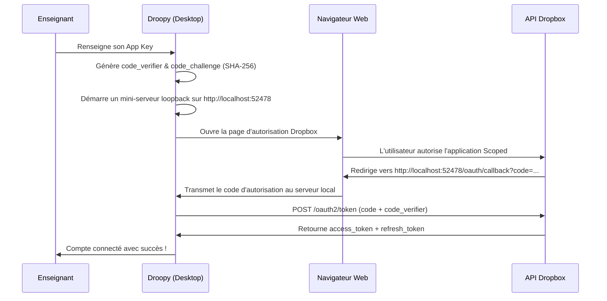

# 🛠️ Architecture Technique de Droopy v5

Ce document décrit en détail l'architecture logicielle, le modèle de sécurité cryptographique et les protocoles techniques mis en œuvre dans **Droopy v5**.

---

## 📑 Sommaire

1. [Vue d'ensemble & Philosophie Architecturale](#1-vue-densemble--philosophie-architecturale)
2. [Stack Technologique](#2-stack-technologique)
3. [Structure du Projet](#3-structure-du-projet)
4. [Cycle des Données & Arborescence du Dossier Source](#4-cycle-des-données--arborescence-du-dossier-source)
5. [Moteur de Traitement PDF & Découpage](#5-moteur-de-traitement-pdf--découpage)
6. [Intégration Dropbox : OAuth PKCE & Scoped App](#6-intégration-dropbox--oauth-pkce--scoped-app)
7. [Modèle Cryptographique du Portail Web (AES-256 GCM)](#7-modèle-cryptographique-du-portail-web-aes-256-gcm)
8. [Guide de Compilation & Environnement Local](#8-guide-de-compilation--environnement-local)

---

## 1. Vue d'ensemble & Philosophie Architecturale

Droopy est conçu selon trois principes cardinaux :

1. **Zero-Server (Souveraineté des données)** : Droopy n'utilise aucun serveur intermédiaire de télémétrie, de base de données ou de relais. Tout le traitement métier est exécuté en local sur la machine de l'enseignant.
2. **Zero-Knowledge (Confidentialité élèves)** : Les liens d'accès aux copies corrigées sont chiffrés individuellement avec le mot de passe de l'élève avant toute publication. L'hébergeur statique (Netlify, GitHub Pages, etc.) ne peut mathématiquement pas connaître le contenu des partages.
3. **Légèreté & Performance Native** : L'utilisation de **Tauri 2 (Rust)** permet de produire un binaire natif macOS compact (< 15 Mo), avec une consommation mémoire minime (~60 Mo de RAM en fonctionnement) et une vitesse d'exécution instantanée.

---

## 2. Stack Technologique

| Couche | Technologie | Rôle |
|---|---|---|
| **Moteur Desktop** | **Tauri v2 (Rust)** | Système de fichiers natif, dialogues macOS, loopback HTTP pour OAuth, commandes système sécurisées. |
| **Frontend UI** | **Vue 3 (Composition API)** | Interface réactive, état applicatif centralisé, transitions fluides. |
| **Composants & Thème** | **PrimeVue v4 (Aura Preset)** + **TailwindCSS** | Composants UI professionnels, support natif du mode sombre / clair, accessibilité. |
| **Manipulation PDF** | **pdf-lib** | Découpage ultra-rapide des flux PDF sans ré-encodage, assemblage des étiquettes et des récapitulatifs. |
| **Rendu & Zoom PDF** | **pdfjs-dist** | Rendu Canvas haute fidélité du haut de copie pour l'identification des élèves. |
| **Cryptographie** | **WebCrypto API (Standard W3C)** | Chiffrement symétrique AES-256-GCM et dérivation de clé PBKDF2 pour le portail web. |
| **Parsing Données** | **PapaParse** | Analyse et nettoyage robuste des fichiers CSV issus des logiciels de vie scolaire. |

---

## 3. Structure du Projet

```text
droopy-v4/
├── docs/                        # Documentation GitHub & Vitrine GitHub Pages
│   ├── index.html               # Site vitrine officiel (GitHub Pages)
│   ├── GUIDE_ENSEIGNANT.md      # Manuel utilisateur complet
│   └── ARCHITECTURE_TECHNIQUE.md# Ce document
├── public/                      # Assets publics statiques (logo.png, icônes)
├── src-tauri/                   # Backend Rust / Tauri
│   ├── src/
│   │   ├── main.rs              # Point d'entrée Rust, enregistrement des commandes
│   │   └── lib.rs               # Fonctions natives (filesystem, loopback server, Dropbox root)
│   ├── Cargo.toml               # Dépendances Rust
│   └── tauri.conf.json          # Configuration de l'application desktop (fenêtre 1600x1200, bundle)
└── src/                         # Frontend Vue 3
    ├── assets/                  # Feuilles de style globales et icônes
    ├── components/              # Composants graphiques
    │   ├── HeaderBar.vue        # Barre supérieure : logo 40px, ButtonGroup paramètres, stepper
    │   ├── SplashScreen.vue     # Checklist séquentielle de démarrage en 4 étapes
    │   ├── Step0Students.vue    # Carnet de classe : tableau, imports CSV, génération lots
    │   ├── Step1Import.vue      # Chargement du scan PDF et paramétrage du devoir
    │   ├── Step2Identify.vue    # Volet de reconnaissance ultra-fluide avec zoom Canvas
    │   ├── Step3Distribution.vue# Récapitulatif des notes, découpage et distribution Dropbox
    │   ├── SettingsDialog.vue   # Boîte de dialogue : choix du dossier Source, thème
    │   ├── DropboxQuickSetupDialog.vue # Assistant guidé de configuration de l'App Key
    │   └── PortalQuickSetupDialog.vue  # Assistant de personnalisation du portail web
    ├── services/                # Logique métier et couches d'abstraction
    │   ├── nativeFs.js          # Pont avec les commandes Tauri Rust (FS, dossiers)
    │   ├── storage.js           # Stockage des préférences globales (thème, Dropbox tokens)
    │   ├── dropboxService.js    # Communication API Dropbox v2 (OAuth PKCE, partages)
    │   ├── studentService.js    # Gestion du fichier eleves.json et structure Source
    │   ├── pdfService.js        # Découpage, génération d'étiquettes et tableaux PDF
    │   └── portalGeneratorService.js # Compilation et export du portail web chiffré
    ├── App.vue                  # Composant racine, orchestration du flux de travail
    └── main.js                  # Initialisation de l'application Vue et PrimeVue
```

---

## 4. Cycle des Données & Arborescence du Dossier Source

Droopy adopte une architecture dite **« Source-Centric »**. Toutes les données d'un enseignant résident dans un dossier unique choisi sur son Mac (idéalement dans son arborescence Dropbox locale) :

```text
Dossier_Source/
├── eleves.json                  # Registre des élèves : noms, classes, mots de passe, URLs partagées
├── settings.json                # Préférences du dossier : URL portail, thème, timestamps
├── Documents/                   # Espace pour documents généraux de l'enseignant
└── Evaluations/
    ├── A corriger/              # Dossier de dépôt des scans PDF issus du photocopieur
    ├── Backup/                  # Sauvegarde horodatée des paquets complets scannés
    └── Eleves/                  # Dossiers individuels de distribution
        ├── 4eme B/
        │   ├── DUPONT Lucas/
        │   │   └── 2026-11-01 - 4eme B - Devoir 1 - DUPONT Lucas.pdf
        │   └── MARTIN Emma/
        └── 3eme 1/
```

### Format du fichier `eleves.json`
Chaque entrée d'élève contient les attributs suivants :
```json
{
  "id": 1,
  "name": "DUPONT Lucas",
  "classe": "4eme B",
  "password": "kiwi-bleu-42",
  "isFolder": true,
  "urlDropbox": "https://www.dropbox.com/scl/fo/abc123xyz...",
  "isDropboxFolder": true,
  "isShared": true
}
```

---

## 5. Moteur de Traitement PDF & Découpage

Le traitement des PDF d'évaluations se décompose en deux phases distinctes :

### Phase 1 : Rendu haute définition pour l'identification (`pdfjs-dist`)
- Lors de l'étape 2, le PDF est chargé dans un `PDFDocumentLoadingTask`.
- La première page de chaque copie est rendue sur un `<canvas>` HTML5 avec un ratio de grossissement adaptatif (scale 1.8 à 2.2).
- Le composant applique un masque de découpage dynamique sur le **quart supérieur de la copie**, zone où figurent conventionnellement le nom, prénom et la note attribuée par le professeur.

### Phase 2 : Découpage sans perte et ré-assemblage (`pdf-lib`)
- Contrairement aux outils traditionnels qui rastérisent les pages en images JPEG (dégradant la qualité et alourdissant le fichier), Droopy utilise `pdf-lib` pour **extraire directement les flux d'objets vectoriels** :
  ```javascript
  const subPdf = await PDFDocument.create();
  const copiedPages = await subPdf.copyPages(sourceDoc, pageIndices);
  copiedPages.forEach(p => subPdf.addPage(p));
  const pdfBytes = await subPdf.save();
  ```
- **Performance** : Un document de 120 pages est scindé en 30 copies individuelles en **moins de 2 secondes**, avec une préservation intégrale de la netteté des annotations manuscrites au stylet.

---

## 6. Intégration Dropbox : OAuth PKCE & Scoped App

Pour éviter de faire transiter des identifiants sensibles par un serveur tiers, Droopy implémente le flux standard **OAuth 2.0 avec PKCE (Proof Key for Code Exchange)** directement sur le Mac :



### Avantages pour la sécurité :
1. **Pas de secret d'application codé en dur** : Le protocole PKCE élimine le besoin d'un `client_secret` pouvant être extrait du binaire.
2. **Permissions strictes (*Scoped App*)** : Droopy ne demande l'accès qu'à son propre dossier d'application (`files.metadata.read`, `sharing.read`, `sharing.write`, `account_info.read`), sans aucun accès au reste du compte Dropbox de l'utilisateur.

---

## 7. Modèle Cryptographique du Portail Web (AES-256 GCM)

Le portail web de consultation est une **Single Page Application statique** sans backend de base de données. Sa sécurité repose sur un chiffrement symétrique côté client :

### Chiffrement à la génération (`portalGeneratorService.js`)
Pour chaque élève :
1. **Identifiant normalisé** : `login = "prenom.nom"` (minuscules, sans accents).
2. **Hash d'indexation** : `loginHash = SHA-256(login)`. Ce hash sert de clé publique d'index dans le fichier de données (l'annuaire ne contient aucun nom en clair).
3. **Dérivation de clé (PBKDF2)** :
   - Algorithme : PBKDF2 avec SHA-256.
   - Entrée : Mot de passe de l'élève (ex: `kiwi-bleu-42`).
   - Sel : 16 octets aléatoires cryptographiques (`crypto.getRandomValues`).
   - Itérations : **100 000 itérations**.
4. **Chiffrement symétrique (AES-GCM)** :
   - Algorithme : **AES-GCM 256 bits**.
   - Vecteur d'initialisation (IV) : 12 octets aléatoires uniques par copie.
   - Charge utile chiffrée : JSON contenant `{ urlDropbox: "...", name: "...", classe: "..." }`.

### Déchiffrement dans le navigateur de l'élève
Lorsque l'élève saisit son identifiant et son mot de passe sur le portail :
1. Le navigateur calcule `SHA-256(identifiant)` et extrait le bloc chiffré correspondant dans le dictionnaire `data.js`.
2. Il applique la dérivation PBKDF2 sur le mot de passe saisi avec le sel stocké.
3. Il déchiffre la charge utile via `window.crypto.subtle.decrypt`.
4. Si le mot de passe est erroné, la vérification du tag GCM échoue automatiquement avec une exception cryptographique, affichant une erreur sans révéler aucune information.

---

## 8. Guide de Compilation & Environnement Local

### Prérequis système (macOS)
- **Node.js** v18+ ou v20+ avec npm.
- **Rust & Cargo** : installables via `curl --proto '=https' --tlsv1.2 -sSf https://sh.rustup.rs | sh`.
- **Xcode Command Line Tools** : `xcode-select --install`.

### Commandes usuelles

```bash
# 1. Cloner le dépôt
git clone https://github.com/rrigaud/droopy.git
cd droopy

# 2. Installer les dépendances JavaScript
npm install

# 3. Lancer en mode développement (Vite + Tauri)
npm run tauri dev

# 4. Compiler le binaire de production (.dmg pour macOS)
npm run tauri build
```

Le fichier `.dmg` d'installation universel est généré dans :  
`src-tauri/target/release/bundle/dmg/Droopy_5.0.0_universal.dmg`.

---

*Droopy est un projet sous licence libre MIT, développé pour la communauté enseignante.*
