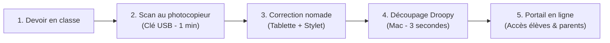

# 📖 Guide Utilisateur Droopy — Le Manuel de l'Enseignant

Bienvenue dans le guide officiel de **Droopy** ! Ce manuel pas-à-pas est conçu pour vous accompagner dans la mise en place d'un flux de correction moderne, nomade et sans douleur.

---

## 📑 Sommaire

1. [La Philosophie de Droopy : La Correction Nomade](#1-la-philosophie-de-droopy--la-correction-nomade)
2. [Installation & Premier Lancement sur macOS](#2-installation--premier-lancement-sur-macos)
3. [Étape 0 : Préparation des Classes & des Élèves](#3-étape-0--préparation-des-classes--des-élèves)
   - [Importer une liste d'élèves (CSV)](#importer-une-liste-délèves-csv)
   - [Générer les mots de passe et les dossiers locaux](#générer-les-mots-de-passe-et-les-dossiers-locaux)
   - [Imprimer les étiquettes de rentrée pour les cahiers](#imprimer-les-étiquettes-de-rentrée-pour-les-cahiers)
4. [Le Workflow de Correction Nomade au Quotidien](#4-le-workflow-de-correction-nomade-au-quotidien)
   - [1. Le Scan Express au photocopieur](#1-le-scan-express-au-photocopieur)
   - [2. La Correction sur tablette avec stylet](#2-la-correction-sur-tablette-avec-stylet)
   - [3. Le Découpage & Relevé des notes dans Droopy](#3-le-découpage--relevé-des-notes-dans-droopy)
5. [Distribution Dropbox & Portail Web des Élèves](#5-distribution-dropbox--portail-web-des-élèves)
   - [Pourquoi Dropbox ? (L'App Scoped 100% sécurisée)](#pourquoi-dropbox--lapp-scoped-100-sécurisée)
   - [Configuration de l'App Key Dropbox en 2 minutes](#configuration-de-lapp-key-dropbox-en-2-minutes)
   - [Générer et héberger le Portail Web](#générer-et-héberger-le-portail-web)
   - [Comment les élèves et parents consultent leurs copies](#comment-les-élèves-et-parents-consultent-leurs-copies)
6. [Foire Aux Questions & Confidentialité RGPD](#6-foire-aux-questions--confidentialité-rgpd)

---

## 1. La Philosophie de Droopy : La Correction Nomade

### Le problème du papier
Chaque enseignant le sait : corriger 4 classes de 30 élèves, c'est porter un cartable de 10 kg de copies papier. Mais surtout, **le papier nous immobilise** : pour corriger, il faut une grande table, du calme et du temps. Impossible d'avancer 15 minutes dans une salle d'attente, au café, dans les transports ou pendant l'activité sportive de ses enfants le mercredi après-midi.

### La solution : La tablette tactile
En scannant un paquet de copies, 140 évaluations tiennent dans un iPad ou une tablette numérique. Avec un stylet, on retrouve le même confort qu'au stylo rouge, mais **avec la liberté de corriger n'importe où et n'importe quand**, par petites sessions efficaces.

### Le rôle de Droopy : Le chaînon manquant
Une fois les 140 copies corrigées dans un seul gros fichier PDF annoté... **comment les rendre aux élèves sans y passer ses nuits ?**
C'est là qu'intervient **Droopy** :
- Il découpe automatiquement le gros PDF en copies individuelles.
- Il extrait le tableau des notes prêt à être collé dans Pronote, Notion ou votre tableur.
- Il dépose chaque copie dans le dossier Dropbox de l'élève.
- Les élèves et leurs parents y ont accès sur un portail web moderne et chiffré.

> **Le saviez-vous ?** Le nom **DROOPY** est né de la contraction de **DRO**pbox + c**OPY**, en hommage à la célèbre mascotte de dessin animé réputée pour sa flegme légendaire : *le logiciel travaille pendant que vous profitez de votre temps libre.*

---

## 2. Installation & Premier Lancement sur macOS

### Prérequis
- Un ordinateur Mac (Apple Silicon M1/M2/M3/M4 ou processeur Intel).
- macOS 12 (Monterey) ou supérieur (Ventura, Sonoma, Sequoia).
- Un compte Dropbox personnel (la version gratuite de 2 Go suffit largement pour plusieurs années de copies PDF).

### Installation
1. Téléchargez la dernière version de **Droopy (`.dmg`)** depuis la page des [Releases GitHub](https://github.com/rrigaud/droopy/releases).
2. Ouvrez le fichier téléchargé et **glissez l'icône Droopy dans votre dossier Applications**.
3. Lancez Droopy. *(Si macOS affiche un message de sécurité au premier lancement, faites Clic-droit sur l'application > « Ouvrir » > confirmez l'ouverture).*

### Le Dossier « Source »
Au tout premier lancement, Droopy vous demande de choisir un **Dossier Source** :
- **Conseil recommandé** : Choisissez un dossier situé à l'intérieur de votre dossier Dropbox local (par exemple : `~/Dropbox/DroopySource`).
- Droopy crée automatiquement à l'intérieur l'arborescence requise :
  - `eleves.json` : la base de données locale de vos élèves.
  - `Evaluations/A corriger/` : où vous déposerez vos scans à traiter.
  - `Evaluations/Backup/` : archive automatique des évaluations complètes.
  - `Evaluations/Eleves/` : un sous-dossier par classe et par élève.

---

## 3. Étape 0 : Préparation des Classes & des Élèves

L'onglet **« Élèves »** (Step 0) est votre carnet de classe numérique.

### Importer une liste d'élèves (CSV)
1. Exportez la liste de vos élèves depuis votre logiciel de vie scolaire (**Pronote**, **Siècle**, **MonBureauNumérique**, etc.) au format CSV.
2. Dans Droopy, cliquez sur **« Importer un CSV »**.
3. Associez les colonnes correspondantes :
   - Colonne **Classe** (ex: *4ème B*, *3e1*...)
   - Colonne **Nom & Prénom** (ou Nom puis Prénom)
4. Validez : vos élèves sont instantanément ajoutés.

### Générer les mots de passe et les dossiers locaux
En haut du tableau, vous disposez d'un bouton d'action par lot **« Générer... »** :
1. **Les dossiers** : Crée en 1 seconde le sous-dossier physique de chaque élève sur votre disque dur.
2. **Les mots de passe** : Attribue à chaque élève un mot de passe simple et mémorisable (ex: *kiwi-bleu-42*).

### Imprimer les étiquettes de rentrée pour les cahiers
Pour éviter de perdre du temps en début d'année :
1. Cliquez sur **« Les étiquettes Élèves »** dans la barre d'actions.
2. Droopy génère un document PDF haute résolution, prêt à être imprimé (format 2 colonnes).
3. Découpez et faites coller ces étiquettes sur la première page du cahier ou du classeur des élèves. Chaque étiquette contient :
   - Le nom et la classe de l'élève.
   - Son identifiant personnel.
   - Son mot de passe de consultation.
   - L'adresse web du portail de consultation.

---

## 4. Le Workflow de Correction Nomade au Quotidien

Voici la routine ultra-rapide à adopter pour chaque devoir :

### 1. Le Scan Express au photocopieur
- À la fin du cours, posez le paquet complet de copies sur le chargeur automatique du photocopieur de votre école ou collège.
- Branchez votre clé USB et lancez la numérisation vers la clé USB.
- **Résultat** : En 60 secondes, vos 30 copies (soit 60 à 120 pages) sont numérisées dans un unique fichier PDF.

### 2. La Correction sur tablette avec stylet
- Branchez la clé sur votre Mac ou déposez le PDF dans votre Dropbox.
- Ouvrez le PDF sur votre **iPad ou tablette tactile** dans votre application préférée (**GoodNotes**, **Notability**, **Noteful**, **Apple Notes**, **Acrobat**...).
- **Vous êtes libre !** Corrigez au stylet dans votre canapé, au soleil, dans les transports ou entre deux cours. Vous n'avez plus aucun papier à transporter.
- *Astuce note* : Inscrivez la note sur la première page de chaque copie, au même endroit (en haut à droite par exemple).

### 3. Le Découpage & Relevé des notes dans Droopy
Une fois tout le paquet annoté :
1. **Étape 1 (Chargement)** : Ouvrez Droopy sur votre Mac, glissez votre PDF corrigé, choisissez la classe et le nombre de pages par copie (ex: 2 pages par élève).
2. **Étape 2 (Identification)** : Droopy affiche un zoom haute définition sur le haut de chaque copie.
   - Tapez les premières lettres du nom de l'élève au clavier > tapez sa note > appuyez sur **Entrée**.
   - Le logiciel passe automatiquement à la copie suivante ! L'identification des 30 copies prend moins de 60 secondes.
3. **Étape 3 (Distribution)** :
   - Cliquez sur **« Distribuer les copies »** : Droopy découpe les copies au format PDF individuel et les range dans le dossier Dropbox de chaque élève.
   - Cliquez sur **« Exporter les notes »** : Droopy copie dans votre presse-papier le tableau complet des notes (`Nom \t Note`), prêt à être collé en un clic dans **Notion**, **Excel**, **Numbers** ou votre carnet de notes **Pronote** !

---

## 5. Distribution Dropbox & Portail Web des Élèves

### Pourquoi Dropbox ? (L'App Scoped 100% sécurisée)
Droopy n'héberge aucune copie sur un serveur tiers : il utilise **votre propre compte Dropbox personnel** (le forfait gratuit standard suffit amplement).

Pour votre sécurité, Droopy utilise une application Dropbox dite **« Scoped »** :
- Droopy **n'a pas accès à vos photos de famille ni à vos documents personnels**.
- Il ne peut voir et modifier que son propre sous-dossier dédié (`/Apps/Droopy/`).

### Configuration de l'App Key Dropbox en 2 minutes
Lors du premier lancement (ou depuis les Paramètres ⚙️ > onglet Dropbox) :
1. Rendez-vous sur le [Portail Développeurs Dropbox](https://www.dropbox.com/developers/apps/create).
2. Choisissez **Scoped access** et **App folder** (nommez votre application, par exemple `Droopy-MonCollege`).
3. Dans l'onglet **Permissions**, cochez les 4 autorisations suivantes :
   - `files.metadata.read`
   - `sharing.read`
   - `sharing.write`
   - `account_info.read`
4. Dans l'onglet **Settings**, copiez votre **App Key** et collez-la dans Droopy.
5. Cliquez sur **« Connecter mon compte »** : une page web s'ouvre pour autoriser la connexion sur votre Mac. C'est terminé !

### Générer et héberger le Portail Web
Pour que vos élèves puissent voir leurs copies :
1. Dans l'onglet Élèves (Step 0), cliquez sur le bouton **« Générer le portail de connexion »**.
2. Droopy crée le fichier web `index.html` (avec le design cosmique *Émeraude & Constellation*) et le fichier chiffré `data.js`.
3. Vous pouvez héberger ces deux petits fichiers gratuitement en quelques secondes sur :
   - **Netlify** (glissez-déposez le dossier généré sur [app.netlify.com/drop](https://app.netlify.com/drop)).
   - **GitHub Pages** (gratuit, directement depuis un dépôt).
   - Le serveur web de votre établissement ou votre site personnel.

### Comment les élèves et parents consultent leurs copies
- L'élève ouvre l'adresse web du portail depuis n'importe quel appareil connecté à Internet :
  - **Smartphone** (iPhone, Android)
  - **Tablette** (iPad, tablette Android)
  - **Ordinateur** (PC, Mac, Chromebook)
  - **Et même une console de salon** (PlayStation 5, Nintendo Switch) ou la télévision connectée du salon !
- L'élève saisit son **identifiant** et son **mot de passe personnel**.
- Son navigateur déchiffre instantanément son lien Dropbox sécurisé en local (via l'algorithme AES-256 GCM) et ouvre sa copie corrigée avec vos annotations au stylet.
- **Astuce mobile (PWA)** : Sur smartphone, l'élève peut toucher *Partager > Sur l'écran d'accueil* pour installer le portail comme une véritable application native.

---

## 6. Foire Aux Questions & Confidentialité RGPD

### Mes données ou celles des élèves vont-elles sur Internet ?
**Non, absolument aucune donnée nominative ne transite par un serveur externe.**
- Droopy fonctionne **100% hors-ligne sur votre Mac**.
- Les copies sont stockées exclusivement sur votre compte Dropbox personnel.
- Les données de connexion sur le portail web sont chiffrées de bout en bout : même si un tiers téléchargeait le portail, il lui serait mathématiquement impossible de lire les liens ou les notes sans le mot de passe individuel de chaque élève.

### Que faire si un élève a été absent lors de l'évaluation ?
Lors de l'étape 2 (Identification), Droopy vous signale automatiquement les élèves de la classe qui n'ont pas reçu de copie. À l'étape 3, leur statut est clairement indiqué comme **« Absent »**. Aucune copie n'est créée pour eux, et leur note n'impacte pas la moyenne.

### Combien coûte Droopy ?
**Droopy est 100% gratuit et open source.**
Il n'y a aucun abonnement, aucun achat intégré, aucune publicité.

---

*Développé avec passion pour faire gagner du temps aux enseignants.*  
*Pour signaler une idée ou un problème, rendez-vous sur le [dépôt GitHub](https://github.com/rrigaud/droopy/issues).*
